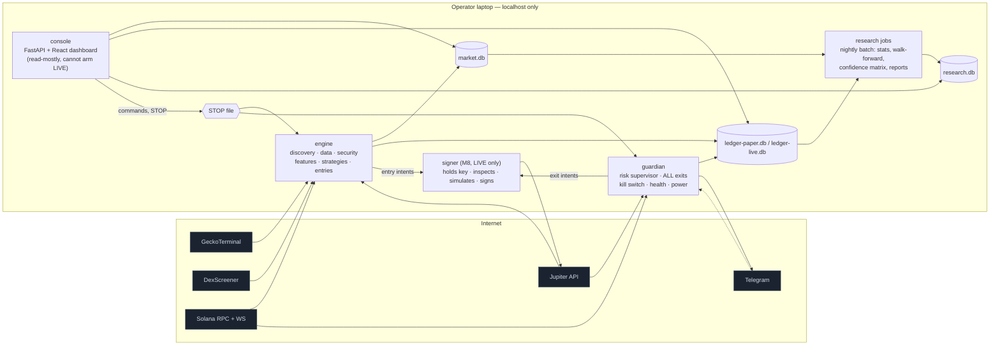

# PLAN.md — Solana Quant Desk (working brand: **KESTREL**)

**Status:** Plan **approved 2026-10-18**; M1 passed; M2 in progress. Operator answers and acceptance evidence are recorded in §24 and PROGRESS.md.
**Companion documents:** `RESEARCH.md` (verified facts + evidence), `ACCEPTANCE.md` (milestone tests),
`PROGRESS.md` (session-to-session state), `research/provider_registry.yaml` (machine-readable provider registry).

> Guiding principle (from the spec): **Data code observes. Models evaluate. Statistical evidence validates.
> Deterministic code executes. Risk management overrides everything.**
> The objective is not a bot that *believes* it is profitable; it is a system that can *discover whether* a
> repeatable, executable, statistically defensible edge exists — and stay in PAPER indefinitely if it doesn't.

---

## Table of contents
1. [Executive summary and honest feasibility verdict](#1-executive-summary-and-honest-feasibility-verdict)
2. [Compensatory angles of attack (how a home laptop can compete)](#2-compensatory-angles-of-attack)
3. [Critical review of the specification](#3-critical-review-of-the-specification)
4. [System architecture](#4-system-architecture)
5. [Project structure and module responsibilities](#5-project-structure-and-module-responsibilities)
6. [Data contracts](#6-data-contracts)
7. [Storage, audit, and replay](#7-storage-audit-and-replay)
8. [Data providers and rate budgets](#8-data-providers-and-rate-budgets)
9. [Discovery and the opportunity funnel](#9-discovery-and-the-opportunity-funnel)
10. [Security engine](#10-security-engine)
11. [Features, regimes, and strategy hypotheses](#11-features-regimes-and-strategy-hypotheses)
12. [Paper execution model](#12-paper-execution-model)
13. [Position sizing, risk engine, and global limits](#13-position-sizing-risk-engine-and-global-limits)
14. [Confidence matrix, statistics, and promotion thresholds](#14-confidence-matrix-statistics-and-promotion-thresholds)
15. [AI judge — removed by operator decision](#15-ai-judge--removed-by-operator-decision)
16. [LIVE executor and wallet security](#16-live-executor-and-wallet-security)
17. [Dashboard: stack, design system, and branding](#17-dashboard-stack-design-system-and-branding)
18. [Operating on the operator's laptop](#18-operating-on-the-operators-laptop)
19. [Dependencies](#19-dependencies)
20. [Operating costs](#20-operating-costs)
21. [Expected bottlenecks](#21-expected-bottlenecks)
22. [Milestones](#22-milestones)
23. [Risk register](#23-risk-register)
24. [Decisions needed from the operator](#24-decisions-needed-from-the-operator)

---

## 1. Executive summary and honest feasibility verdict

**What will be built:** a locally operated Solana memecoin research-and-trading desk made of a small number of
cooperating Python processes, SQLite databases (market, per-mode ledgers, research, plus a tiny runtime-coordination file), a premium React dashboard served by FastAPI on `localhost`,
and — only in M8 and only when explicitly armed — an isolated transaction signer.

**What the research showed (details in RESEARCH.md):**

| Fact | Consequence |
|---|---|
| Quote-implied **round-trip cost 2.2–4.1%** on $22k–$59k-liquidity memecoins (0.1–1 SOL) | Strategies need a large gross edge per trade; prefer deeper pools; trade rarely |
| Market data is **cached 30–60 s** at the source; public RPC ~150–400 ms per call | No sniping. Target **15-minute to 24-hour** holding periods |
| GeckoTerminal ≈ **10 calls/min**, erratic | GT is for discovery + OHLCV backfill only; DexScreener (300/min) refreshes |
| New pump.fun tokens are **Token-2022** | Extension allow-list, not a blanket Token-2022 ban |
| Public RPC 429'd `getTokenLargestAccounts` | Free keyed RPC needed for holder analysis (Helius free: 1M credits/mo) |
| Raw launch rate ≈ **2 tokens/s**; full log stream ≈ **19 GB/day** | Do not ingest the firehose; track survivors |
| Only ~2% of an active token's volume was labelled "organic" by Jupiter | Volume-based signals are dominated by bots; distinct-trader and organic metrics matter |

**Honest verdict.** Building the system is feasible on the operator's hardware at **$0/month** in service costs (free tiers only; no paid APIs).
Whether it can make money is **unknown and cannot be promised**. The 3–5% per-trade cost hurdle, fat-tailed
returns, and fast-changing memecoin "metas" mean that:

- Even if a real edge exists, demonstrating it statistically will likely take **~300–700 closed paper trades**
  (§14.4) — realistically **2–6 months** of forward paper trading, not 7 days.
- A very plausible outcome is that the system concludes **"no defensible edge — remain in PAPER"**. The design treats
  that as a successful, capital-preserving result, not a failure.

---

## 2. Compensatory angles of attack

The operator's setup (laptop, Wi-Fi, home connection, free data tiers) cannot win races measured in milliseconds.
The plan therefore deliberately competes **where speed is not the deciding factor**. Each angle below is a *hypothesis
to be tested*, not a promise.

| # | Angle | Why a slow participant is not disadvantaged | Where it lives in the design |
|---|---|---|---|
| A1 | **Horizon shift** — trade minutes-to-hours, never the first seconds | A 2–5 s latency is negligible against a 1–6 h holding period; the sniper window is ceded on purpose | Funnel Stage 1 minimum age (default 15 min after first pool); strategies H1–H6 |
| A2 | **Avoidance edge** — superior rejection of rugs, serial launchers, honeypots, hostile token extensions | Most memecoin losses come from *what* is bought, not *when*. Filtering is computed once per token and is not latency-sensitive | Security engine (§10), dev-history features (`devMints` up to 13,477 observed), counterfactual tracking proves whether filters help |
| A3 | **Fade the fast money** — enter after the sniper/bot spike exhausts, on verified pullbacks with liquidity intact | Lets faster players take the most violent segment; we buy only after evidence of survival | H2 "sniper-exhaustion pullback", H4 "volume-expansion pullback" |
| A4 | **Second-wave / older tokens** — revived activity on tokens >24 h old | Far less competition from launch snipers; more history for features; deeper pools → lower costs | H6 "renewed-activity" |
| A5 | **Delegate transaction landing** — use Jupiter's managed `/execute` (priority fees, routing, landing) | Outsources the part of execution where home Wi-Fi latency would hurt most | LIVE executor (§16); paper model measures quote age & latency |
| A6 | **Cost discipline** — trade rarely, only in deep pools, refuse trades whose *measured* round-trip quote cost exceeds a cap | Cost is the biggest known enemy (2–4%); patience is free | Sizing returns zero when cost/fee floor fails (§13); NO-TRADE always ranked |
| A7 | **Watch only what you hold, in real time** — WebSocket `accountSubscribe` on held positions' pool vaults and mint (a handful of accounts, not the firehose) | Liquidity pulls and authority changes on *your* positions are detected within ~1 s of confirmation at trivial bandwidth | Guardian process (§13.3) |
| A8 | **Proprietary dataset** — log every candidate, rejection, quote, and forward outcome | Most retail bots never measure counterfactuals; the dataset compounds over months | Rejection ledger, counterfactuals (§11.6), replay (§7.4) |
| A9 | **Statistical honesty as risk control** — the system refuses LIVE until evidence exists | Avoids the most common way small traders lose money: trading an unproven idea | Confidence matrix (§14), readiness report (M9) |

What we explicitly **do not** attempt: first-block sniping, copy-trading of "smart wallets" via paid feeds, MEV,
market-making, leverage, or any strategy whose edge depends on being faster than co-located bots.

If measured evidence later shows latency *is* the binding constraint for a promising hypothesis, an optional
low-cost always-on relay (e.g. a small VPS reachable over the operator's existing Tailscale network) can be proposed
then — with costs and approval — but it is **not** part of the default design.

---

## 3. Critical review of the specification

The specification is unusually thorough and safety-minded; almost everything is kept. The following changes are
proposed because the research or the operator's constraints make the original wording unrealistic, ambiguous, or
risky.

### 3.1 Unrealistic or ambiguous requirements (and the replacement)

| Spec item | Problem | Proposal |
|---|---|---|
| "Seven days of paper trading is a minimum" | Correct as a floor, but statistically meaningless for fat-tailed returns | Promotion requires sample-size criteria (§14.4): ≥300 trades, ESS ≥150, ≥60 days, ≥2 regimes |
| "Partial execution where genuinely applicable" | Jupiter swaps are atomic (all-or-nothing with a min-out threshold); partial fills don't occur | Model partial execution only for *our own* multi-tranche exits |
| AI judge (incl. SOCIAL question set) | Requires a paid API; operator declined. Social data also has no affordable, permitted source | **Removed.** Deterministic-only desk; local statistical models in M6 take the "models evaluate" role (§15) |
| Volume-decay rule `avg_6h = volume_24h / 4` | **Biased for tokens younger than 24 h**: `volume_24h` then covers only the token's age, so the ratio `volume_6h / avg_6h ≈ 4·v6/v24` stays high and the rule almost never fires | Keep the original as research hypothesis `VD-orig`; add age-adjusted `VD-adj`: `avg_6h = volume_24h · 6 / clamp(age_h, 6, 24)`; compare empirically |
| "Unique active trading addresses" | Measurable only via GT `buyers/sellers` and Jupiter `numTraders` (undocumented definition) | Use both, labelled by provider; never derive from transaction counts |
| Short-lived volume acceleration strategy | Most latency-sensitive hypothesis; data is 30–60 s stale | Kept as **shadow-only research** until data shows it's viable |
| LIVE activation control in the dashboard | A web UI that can *arm* real-money trading is an attack surface (XSS, CSRF, a stray click) | Dashboard can **show** gates and **disarm** LIVE; **arming is CLI-only** with typed confirmation (§16.5) |
| 26 named tables in one SQLite file | One file mixes a large, disposable market store with the small, critical money ledger | Three databases: `market.db`, `ledger-<mode>.db` (paper and live **physically separate**), `research.db` (§7) |
| "All operating modes use the same code" | Agreed — and strengthened | A single pure decision core; modes differ only in the executor adapter |
| Telegram stop command | Fine, but Telegram is a remote-control channel | Allow-listed chat ID only; commands limited to `/status`, `/stop`; no resume, no LIVE commands |

### 3.2 Missing risks the spec did not mention

| Risk | Mitigation |
|---|---|
| **Stored XSS via token names/descriptions** — attacker-controlled strings rendered in the dashboard | React text rendering only (no raw HTML), strict Content-Security-Policy, **no remote token images** (deterministic identicons from the mint address instead), test fixtures with malicious names |
| **SSRF / tracking via token metadata URIs** — fetching attacker URLs from your home IP | Metadata URIs are never fetched in M1–M3; if ever fetched, a sandboxed fetcher (HTTPS only, public IPs only, ≤64 KB, 3 s, no redirects to private ranges) |
| **Wallet phishing via airdropped spam tokens** | The signer never interacts with tokens it did not buy; unknown token accounts are ignored and listed as "unsolicited" |
| **Copycat/impersonation tokens** (same name/symbol as a trending token) | Feature: symbol-collision count; identity always by mint address, never by symbol |
| **Serial launchers** (devs with thousands of mints) | Dev-history features; hard reject at extreme values (configurable) |
| **Correlated exposure** — many tokens move with SOL and the current "meta"; several tokens from one dev | Exposure caps per dev wallet and per launchpad; SOL-beta tracked in regime features |
| **Single-aggregator dependency** (Jupiter) | Documented single point of failure; risk engine treats Jupiter outage as "exits may be unprotected"; no silent fallback |
| **Provider API drift** (GT is beta; Jupiter moved hosts and versions) | Response-schema validation with explicit failure; stored fixtures; contract tests run by `desk doctor` |
| **Multiple-testing / data-snooping** across strategy variants | Small hypothesis set; permanent experiment registry counts every trial; Holm correction across concurrent challengers (§14) |
| **Regime non-stationarity** — memecoin metas change in weeks | Deterioration monitors (CUSUM / Page-Hinkley), regime-sliced evaluation, automatic demotion to research |
| **Accounting currency ambiguity** | Base currency **SOL** (all trades are SOL-quoted); USD shown as a converted view with the SOL/USD rate at the time |
| **Laptop sleep / Wi-Fi drop / low battery** with open positions | Sleep inhibitor while positions open, resume detector, battery and connectivity entry halts (§18) |
| **Clock skew** | NTP status check at start; compare local time with recent Solana block time; warn if drift > 5 s |
| **Dependency supply chain** (Python and npm) | Hash-locked installs; the signer runs from a minimal-dependency module; the dashboard never handles keys |
| **Tax and legal obligations** | Not legal/tax advice; exports produce a complete per-trade record suitable for an accountant; operator is responsible for local rules |

### 3.3 Unnecessary complexity removed or deferred
- No message broker, no Kubernetes, no Docker requirement, no Postgres (SQLite is ample at this write rate).
- No streaming firehose; WebSocket use is limited to held positions (A7) and an optional cheap migration detector.
- No Telegram library — two HTTP calls via the existing HTTP client.
- No deep-learning models; M6 starts with logistic/regularised models and only escalates with evidence.
- No `solana` RPC SDK; a thin typed JSON-RPC client over `httpx` plus `solders` for types and transaction parsing.

---

## 4. System architecture

### 4.1 Processes

The desk runs as **four long-lived processes** (plus a signer only when LIVE is armed) sharing SQLite files.
Splitting by *failure domain* is what makes the risk engine genuinely independent.



| Process | Owns | Must keep running when… | Never does |
|---|---|---|---|
| **engine** | Discovery, refresh, security dossiers, features, strategy evaluation (champion PAPER + challengers SHADOW), **entries**, counterfactual sampling | — | Exits; signing; reading keys |
| **guardian** | Position monitoring, **all exit decisions and exit execution**, kill switch, global limits, provider/network/power watchdogs, sleep inhibitor, alerts | engine or discovery fail | Open new positions |
| **console** | Dashboard, exports, operator commands (written to a `commands` table / STOP file) | — | Arm LIVE; sign; change safety ceilings |
| **research** | Batch analytics (bootstrap, walk-forward, calibration, confidence matrix, readiness report) — run nightly or on demand with a memory cap | — | Touch live decision state (read-only on ledgers) |
| **signer** (M8) | Encrypted keystore, transaction inspection, simulation, signing, submission via Jupiter `/execute` | Only exists while LIVE is armed | Accept free-form transactions; talk to anything but the allow-listed endpoints |

**Entry rule:** the engine may submit an entry only if the guardian's heartbeat is fresh (< 10 s), because nobody
may hold a position that nobody is supervising. **Exit rule:** exits need only the guardian.

### 4.2 Decision pipeline (one pure core, three modes)

```
observations ─► point-in-time snapshot ─► features ─► strategy rules ─► ranking (incl. NO-TRADE)
                                                         │
     local statistical model score (M6+, logged) ────────┘ (zero influence until validated; never sizes or overrides)
                                                         ▼
                                    deterministic sizing ─► risk authorization ─► executor adapter
                                                                                    ├─ SHADOW: record hypothetical decision
                                                                                    ├─ PAPER:  simulated fill (3 profiles)
                                                                                    └─ LIVE:   signer intent
```

Everything from "point-in-time snapshot" to "risk authorization" is a **pure function of (inputs, config snapshot)**
with no I/O. That property is what makes replay deterministic (§7.4) and lets SHADOW, PAPER and LIVE share code.

### 4.3 Operating modes
- **SHADOW (default):** full pipeline; decisions recorded as hypothetical; no positions, no wallet.
- **PAPER:** simulated wallet (SOL-denominated), position locks, simulated fills under three execution profiles.
- **LIVE (M8+):** only after the gates in §16.5. Uses a physically separate ledger file. Never self-activates.

Reports and the dashboard always display the mode; the LIVE theme is visually unmistakable (§17.4).

---

## 5. Project structure and module responsibilities

The internal Python package is called `desk` (brand-neutral, so the product name can change without code churn).
The CLI is `desk`.

```
cryptomfappdawg/
├─ PLAN.md · RESEARCH.md · ACCEPTANCE.md · PROGRESS.md · README.md
├─ pyproject.toml · uv.lock · .python-version (3.12)
├─ config/
│  ├─ default.toml            # every tunable threshold — ONE authoritative definition, versioned
│  ├─ safety_ceilings.toml    # hard ceilings; changing requires `desk ceilings approve` (typed confirmation)
│  └─ providers.toml          # machine-readable provider registry (supersedes the research/provider_registry.yaml draft)
├─ src/desk/
│  ├─ core/          config loading + snapshot hashing, clock (UTC + monotonic + slot), ids (ULID),
│  │                 structured logging + secret redaction, error taxonomy, units (lamports, raw amounts, Decimal)
│  ├─ contracts/     pydantic models shared by all modules (§6)
│  ├─ storage/       stdlib sqlite3 connections, numbered .sql migrations, repositories, raw store, backup, integrity
│  ├─ providers/     rate limiter (token bucket + adaptive backoff), single-flight cache, HTTP client,
│  │                 geckoterminal.py, dexscreener.py, jupiter.py, solana_rpc.py, solana_ws.py,
│  │                 telegram.py, health.py, registry.py   (no LLM / paid-API clients)
│  ├─ discovery/     source pollers, canonicalisation (mint vs pool), dedup, migration detection, watchlists
│  ├─ security/      token_program.py (SPL vs Token-2022 + extension policy), authorities.py,
│  │                 holders.py (raw/adjusted concentration, account attribution), liquidity.py (LP/vault checks),
│  │                 dev_history.py, sellability.py, dossier.py
│  ├─ features/      registry (definition, unit, source, max age, missing policy), point-in-time builder,
│  │                 momentum.py, activity.py, liquidity.py, holders.py, context.py
│  ├─ regime/        market-regime classifier (versioned, interpretable)
│  ├─ strategies/    base spec + validation, baselines.py, h1_post_migration.py … h6_renewed_activity.py
│  ├─ funnel/        stages 0–9, rejection ledger, ranking with explicit NO-TRADE
│  ├─ portfolio/     sizing (fixed-fraction baseline), limits, position locks, capital reservations
│  ├─ execution/     paper/ (three fill profiles, impairment policy), live/ (intent client, reconciliation),
│  │                 accounting.py (itemised costs, realised/unrealised, SOL + USD views)
│  ├─ risk/          guardian main loop, exit policies, kill switch, global limits, health/power/network watchdogs
│  ├─ research/      outcomes & counterfactuals, evaluation metrics, block bootstrap, walk-forward with purge/embargo,
│  │                 calibration, deterioration monitors, experiment registry, champion/challenger, confidence matrix,
│  │                 readiness report generator
│  ├─ replay/        deterministic event-driven replay from stored snapshots
│  ├─ ops/           `desk doctor`, supervisor, systemd unit installer, laptop power/sleep integration, backups
│  ├─ api/           FastAPI app: JSON endpoints, Server-Sent Events stream, commands, exports, static UI
│  └─ cli.py         `desk up|down|status|doctor|mode|stop|resume|report|export|live …`
├─ src/desk_signer/  (M8) minimal-dependency signer: keystore, tx inspection, simulation, signing, submission
├─ ui/               React + TypeScript + Vite + Tailwind dashboard (built bundle served by `console`)
├─ tests/
│  ├─ unit/ · property/ · e2e/ · fault_injection/
│  ├─ integration/   opt-in live read-only tests (`pytest -m live`)
│  └─ fixtures/      sanitized real provider responses (seeded from research/evidence/)
├─ research/evidence/ M0 probe responses (read-only evidence for RESEARCH.md)
├─ scripts/          setup.sh, build_ui.sh (uses Node if present, else Docker), backup.sh
└─ deploy/systemd/   desk-engine.service, desk-guardian.service, desk-console.service, desk-research.timer
```

**Data directory** (outside the repo, configurable via `DESK_HOME`, default `~/desk-data/`):
`db/`, `backups/`, `logs/`, `raw/` (compressed raw responses), `reports/`, `exports/`, and the `STOP` file.
**Secrets** live in `~/.config/desk/secrets.env` (mode 0600, never committed, never logged). The signer keystore
(M8) lives in `~/.config/desk/signer/` (encrypted at rest, 0600).

---

## 6. Data contracts

All contracts are pydantic v2 models with `strict` validation. Conventions:

- **Money and amounts:** token amounts as `int` raw base units + `decimals`; SOL as `int` lamports; prices and USD
  as `Decimal`. Floats are allowed only in statistics and features, never in ledgers.
- **Time:** timezone-aware UTC `datetime` everywhere; Solana `slot` recorded where available; a monotonic clock is
  used for latency and staleness so wall-clock jumps (e.g. after sleep) can't hide staleness.
- **Unknown is never zero.** Any externally observed value is wrapped:

```python
class DataStatus(StrEnum):
    OK = "ok"; MISSING = "missing"; STALE = "stale"; CONFLICT = "conflict"
    UNVERIFIED = "unverified"; ESTIMATED = "estimated"   # ESTIMATED = model-derived, never a real quote

class Observed(BaseModel, Generic[T]):
    value: T | None                 # None only when status is MISSING
    status: DataStatus
    source: ProviderId              # e.g. "dexscreener.tokens_v1"
    observed_at: datetime           # when WE received it
    provider_as_of: datetime | None # provider's own timestamp, if any
    response_hash: str | None       # sha256 of the raw response stored in raw/
```

Arithmetic helpers refuse `None` (they raise) rather than coercing to 0; features declare their missing-data policy.

### 6.1 Core entities (abridged; full field lists are finalised in M1)

| Model | Key fields |
|---|---|
| `Token` | `mint`, `token_program` (SPL/Token-2022), `decimals`, `supply_raw`, `created_at: Observed`, `dev_wallet: Observed`, `launchpad: Observed` |
| `Pool` | `address`, `mint_base`, `mint_quote`, `venue` (canonical DEX id + per-provider ids), `program_id`, `created_at: Observed`, `vaults: Observed[list]`, `is_bonding_curve` |
| `Discovery` | `discovery_id`, `mint`, `pool`, `source`, `reason` (NEW_TOKEN, NEW_POOL, MIGRATION, RENEWED_ACTIVITY, VOLUME_EXPANSION, ACCELERATION), `first_observed_at`, `raw_ref` |
| `MarketSnapshot` | `mint`, `pool`, `observed_at`, `price_usd/sol`, `liquidity_usd`, `volume.{m5,h1,h6,h24}`, `txns.{…}.{buys,sells}`, `traders.{…}` (where measurable), `fdv`, `market_cap`, `supply_assumption`, `freshness_s`, `completeness` |
| `Quote` | `quote_id`, `side`, `in_mint`, `out_mint`, `in_amount_raw`, `out_amount_raw`, `min_out_raw`, `price_impact_pct`, `router`, `route_labels`, `fee_bps`, `fee_lamports.{signature,priority,rent}`, `requested_at`, `received_at`, `latency_ms`, `context_slot`, `expire_at`, `error_code`, `raw_ref` |
| `SecurityAssessment` | `mint`, `assessed_at`, `slot`, `mint_authority`, `freeze_authority`, `extensions[]` (+ policy verdict each), `holders` (raw & adjusted top1/top10, dev-linked, unclassified, attribution confidence), `liquidity_structure`, `dev_history`, `sellability` (quote-based), `verdict` (PASS / REJECT / INSUFFICIENT_DATA) + reasons, `unprovable[]` |
| `FeatureSnapshot` | `mint`, `as_of`, `feature_set_version`, `values: dict[name, FeatureValue]` (value, unit, source, age_s, status) |
| `Candidate` / `StageResult` | `candidate_id`, `mint`, `stage`, `outcome` (PASS/REJECT/DEFER), `rule_id`, `observed_values`, `thresholds`, `config_hash`, `decided_at` |
| `StrategySpec` / `StrategyVersion` | eligibility, required features, entry/rejection rules, sizing method, stop, trailing, max hold, liquidity exits, execution requirements, invalidation conditions; `version`, `spec_hash`, `parent_version`, `created_at`, immutable once used |
| `Decision` | `decision_id`, `candidate_id`, `strategy_version`, `regime`, `ranking`, `chosen` (incl. NO_TRADE), `model_score_ref` (M6+, optional), `inputs_hash`, `config_hash`, `mode` |
| `Intent` / `Order` / `Fill` | idempotency key, side, size, quote ref, profile, status transitions, itemised costs |
| `Position` | state machine below, entry/exit refs, quantity raw, cost basis lamports, marks (with source label), locks |
| `RiskEvent` | rule id, severity, values, action taken, acknowledged |
| `ModelPrediction` (M6) | local statistical model id + version, training window, feature-set version, inputs hash, score, calibration bucket, influence flag (`none` until validated) |

### 6.2 Position state machine

```
PROPOSED → AUTHORIZED → ENTRY_SUBMITTED → OPEN → EXIT_PENDING → EXIT_SUBMITTED → EXIT_CONFIRMED → RECONCILED
               │               │            │                        │
               ▼               ▼            ▼                        ▼
          REJECTED       ENTRY_FAILED    IMPAIRED ◄────────────── EXIT_FAILED ──(bounded retries)──► EXIT_BLOCKED
                                         (no credible exit;                                       (critical alert;
                                          valued conservatively)                                    exposure preserved,
                                                                                                    lock retained)
```

A position lock is released only at `RECONCILED` (or `ENTRY_FAILED`/`REJECTED`). Restarting never clears
`EXIT_BLOCKED`, `IMPAIRED`, daily loss counters, or halts.

---

## 7. Storage, audit, and replay

### 7.1 Databases (SQLite, WAL mode, `busy_timeout`, short transactions)

| File | Contents | Writers | Backup |
|---|---|---|---|
| `market.db` | tokens, pools, discoveries, market_snapshots, quotes, security_assessments, feature_snapshots, candidates, stage results, rejections, wallet_observations, provider_health, raw_response index | engine (guardian writes quotes) | daily |
| `ledger-paper.db` / `ledger-live.db` | intents, orders, fills, positions, risk_events, daily_pnl, commands, halts/safety state, config_snapshots, strategies, strategy_versions, approvals | engine (entries), guardian (exits, risk) | hourly + on every position state change (online backup API) |
| `research.db` | experiments, strategy_evaluations, counterfactuals, model_predictions, model_calibrations, confidence_matrix, performance_snapshots | research jobs, engine (model_predictions, counterfactual samples) | daily |
| `runtime.db` *(added in M1)* | cross-process coordination only: rate-limit windows, provider health (current + recent transitions), process heartbeats | every process | not backed up (rebuildable) |

Paper and live ledgers are **separate files** so performance histories can never be mixed. A repository layer hides
the physical layout (future Postgres migration = one DB with three schemas).

### 7.2 Raw evidence
Every provider response that feeds a decision is stored compressed in `raw/` keyed by its SHA-256; tables keep the
hash. Retention: decision-linked raw responses forever; others 14 days.

### 7.3 Growth estimate and retention
~0.3–1 M snapshot rows/day at ~250 B → **~75–250 MB/day**, i.e. **~2–7 GB/month** before retention. Snapshots older
than 30 days that aren't linked to a decision are downsampled to 5-minute bars. Target steady state < 20 GB; the
dashboard shows disk usage and warns at 80% of a configurable budget. (Operator has ~290 GB free.)

### 7.4 Replay
The replay engine re-feeds stored point-in-time snapshots (in `observed_at` order) and the stored config snapshot
through the pure decision core and asserts the identical decision hash. Replay outputs are written to `research.db`
with `kind = REPLAY` and are never mixed with forward paper results. Threshold experiments run on copies of inputs.

---

## 8. Data providers and rate budgets

Budgets are deliberately below provider limits and enforced by a **global per-provider token bucket** shared across
processes (state in SQLite) with single-flight request coalescing and TTL caching aligned to each provider's cache.

| Provider | Limit (source) | Our budget | Allocation |
|---|---|---|---|
| GeckoTerminal | ~10/min, erratic (doc + measured) | **≤ 8/min** | `new_pools` p1+p2 every 60 s (2), `trending_pools` (0.5), OHLCV backfill for shortlisted candidates (≤ 4), reserve (1.5) |
| DexScreener | 300/min pair/token endpoints; 60/min profiles/boosts (doc) | **≤ 120/min**, ≤ 10/min on 60-limit endpoints | hot set (≤ 90 tokens) every 30 s → 6/min; warm watchlist (≤ 600) every 3 min → ~7/min; counterfactual checks → ~5/min; promotions feed every 5 min |
| Jupiter (free key) | 60/min shared Swap+Price+Token (doc) | **≤ 50/min** | guardian exit quotes for open positions (≤ 3 × 2/min = 6), entry quotes for Stage-6 survivors (≤ 10), round-trip cost calibration sampling (≤ 10), Tokens v2 (`recent`, categories, batched `search`) (≤ 12), reserve 12 |
| Jupiter keyless (fallback) | 30/min (doc) | ≤ 25/min | same priorities; fewer calibration samples |
| Solana RPC (free keyed, e.g. Helius) | 10 RPS, 1 M credits/month (doc) | **≤ 2 RPS average**, bursts ≤ 5 RPS | security dossiers (~6 calls each), authority re-checks for hot/held tokens, slot/clock, tx status (LIVE). ≈ 200–400 k credits/month |
| Solana WS | public or keyed | ≤ 20 subscriptions | held positions' mint + pool vaults; optional migration detector (verify bandwidth first) |

Every provider entry (endpoint, auth, verified fields, limits, freshness, cost, failure handling, fallback, allowed
usage) was drafted in `research/provider_registry.yaml`; M1 promotes it to `config/providers.toml` with a schema test.

**Failure handling:** each adapter maps failures to `MISSING`/`STALE`, records health, and degrades gracefully. When a
*critical* source for a decision is unavailable, **new entries halt** (plain-English reason on the dashboard), while
the guardian keeps supervising open positions with whatever sources remain and states clearly when it cannot.

---

## 9. Discovery and the opportunity funnel

### 9.1 Discovery sources (engine)
| Source | Cadence | Detects |
|---|---|---|
| GT `new_pools` pages 1–2 | 60 s | new pools incl. migrations (`pumpswap`, `meteora-damm-v2`, `raydium…` pools for existing tokens) |
| Jupiter `/tokens/v2/recent` | 60 s | newly created tokens (sampled; the universe of interest is survivors) |
| Jupiter categories (`toptrending`, `toptraded`, `toporganicscore` × 5m/1h) | 2–5 min | renewed activity, volume expansion |
| GT `trending_pools` (5m/1h) | 2 min | active pools |
| DexScreener boosts/profiles | 5 min | **promoted** tokens — tagged `PROMOTED`, a feature, never a neutral source |
| Watchlist refresh (DexScreener) | 30 s – 3 min | abnormal volume expansion, acceleration, migration of tracked tokens |

Token and pool identities are separate; discoveries dedupe by canonical mint **and** pool address; discovery time,
token creation time and pool creation time are three different fields. Every discovered token is recorded, even if
rejected one millisecond later.

### 9.2 Funnel stages (all outcomes recorded with rule id, values and thresholds)

| Stage | Name | Cost | Default rules (all configurable, all hypotheses) |
|---|---|---|---|
| 0 | Universe | free | Any discovery from approved sources |
| 1 | Free rejection | free | quote token ∈ {SOL, USDC}; **pool age ≥ 15 min**; liquidity **verified** ≥ $40k (missing ⇒ defer/reject, never 0); 1 h volume ≥ $20k; FDV $100k–$50M; snapshot freshness ≤ 120 s; not a bonding curve (default) |
| 2 | Trading activity | DexScreener + GT | 1 h distinct traders ≥ 100 (where measurable); buy/sell imbalance, persistence, volume acceleration, liquidity compatibility recorded |
| 3 | Security dossier | RPC + Jupiter Tokens | authorities, token program, extensions, holders, LP structure, dev history, Shield warnings |
| 4 | Hard rejection | free | §10.4 rules; **sell quote must exist**; quote round-trip cost at the intended ticket ≤ 3.0% |
| 5 | Features | compute (free) | full point-in-time feature snapshot; from M6, local statistical model scores are logged (zero influence until validated) |
| 6 | Strategy screening | free | approved strategy versions evaluate eligibility/entry; challengers evaluate in SHADOW |
| 7 | Ranking | free | by estimated net opportunity, downside, executable liquidity, statistical support; **NO-TRADE is always a ranked option and wins ties** |
| 8 | Risk authorization | free | deterministic limits (§13); only the risk policy can authorize |
| 9 | Execution | Jupiter | SHADOW record / PAPER simulated fill / LIVE signer intent |

A periodic integrity check asserts that every candidate has a terminal stage result or an explicit pending state —
no candidate may vanish from the audit trail.

---

## 10. Security engine

### 10.1 Token program and extensions (fail-closed)
| Extension / condition | Policy |
|---|---|
| SPL Token (classic) | allowed |
| Token-2022 with only `metadataPointer`, `tokenMetadata` (+ account-level `immutableOwner`) | **allowed** (this is the normal pump.fun shape, verified in M0) |
| `transferFeeConfig` | reject (non-zero) — fee erodes every exit; zero-fee with live authority ⇒ reject (can be raised later) |
| `transferHook` | reject (arbitrary program on every transfer) |
| `permanentDelegate` | reject (issuer can move/burn holder tokens) |
| `defaultAccountState = frozen`, `pausable`, `nonTransferable`, `confidentialTransfer*` | reject |
| `mintCloseAuthority`, `interestBearing`, `scaledUiAmount`, group/member pointers | reject by default (insufficiently understood) |
| any extension not in the allow-list | **reject** (unknown ⇒ unsafe) |
| mint authority not null | reject |
| freeze authority not null | reject |

### 10.2 Holder concentration (raw vs adjusted)
- Source: `getTokenLargestAccounts` (top 20 token accounts) + `getMultipleAccounts` to resolve owners.
- **Adjusted** concentration excludes an account **only when verified**: (a) the pool's own vault (owner = verified
  AMM program/PDA *and* referenced by the pool account we decoded), (b) a bonding-curve account of a verified
  launchpad program, (c) a burn/incinerator address. Infrastructure-looking but unverified accounts stay in the
  **"unclassified"** bucket and count against the token.
- Reported: raw top-1, adjusted top-1, raw/adjusted top-10, dev-linked holdings (dev wallet from Jupiter + creator from
  on-chain where decodable), unclassified share, attribution confidence. Jupiter's `topHoldersPercentage` is stored as
  a separate provider claim and compared, never substituted.
- Wallet clustering (shared funding source, synchronized buys) is a **research signal only** and is never presented as
  proven common ownership.

### 10.3 Liquidity structure and exit hazards
- Verify pool vault balances on-chain vs provider liquidity (conflict > 30% ⇒ data-integrity reject).
- LP withdrawal risk per venue: canonical PumpSwap migration pools vs freely created AMM pools (Meteora DAMM v2,
  Raydium, etc.). LP lock/burn verifiability per venue is open item R-08; until verified, non-canonical pools are
  flagged `LP_UNVERIFIED` and rejected by default.
- Sellability: a Jupiter **sell** quote for the intended quantity must exist (necessary, not sufficient). In LIVE, the
  signer additionally simulates the actual transaction (§16). What cannot be proven (documented in every dossier):
  future liquidity, future authority actions (already null ⇒ impossible), program upgrades of the AMM itself, MEV
  during landing, and the state change between simulation and inclusion.

### 10.4 Hard rejection rules (Stage 4, defaults)
Any §10.1 violation · adjusted top-10 > 35% · any single unclassified non-pool holder > 10% · dev-linked holdings > 5%
(if verified) · dev history extreme (default: `devMints` > 500 with migration ratio < 1%; research-tuned later) ·
no sell route · quote round-trip cost > 3.0% at the intended ticket · liquidity missing/unverified · cross-source
price/liquidity conflict > 30% · Jupiter Shield severity ≥ warning on specific types (mapping defined in M2).
**Model scores can never override these.**

---

## 11. Features, regimes, and strategy hypotheses

### 11.1 Feature registry
Each feature has: name, precise definition, unit, source(s), timestamp, **max permitted age**, missing-data policy
(`REJECT_CANDIDATE` | `EXCLUDE_FEATURE` | `IMPUTE_FORBIDDEN`), validation tests, and a version. The point-in-time
builder accepts an `as_of` and may only read rows with `observed_at ≤ as_of`; a test inserts synthetic future rows
and proves outputs don't change.

### 11.2 Feature groups (initial set ≈ 40 features; deliberately small)
- **Momentum:** log returns over 5m/15m/1h/6h; acceleration (Δ return); distance from rolling high; volatility-adjusted
  momentum; breakout/consolidation flags from GT OHLCV + own snapshots.
- **Activity:** buy/sell count ratio; distinct buyers/sellers (GT) and traders (Jupiter, labelled); txn-frequency
  acceleration; median txn size change; volume acceleration; **organic-volume share** (Jupiter claim).
- **Liquidity/execution:** verified liquidity; liquidity change; **quote-implied round-trip cost** at the intended
  ticket; price-impact curve slope (two sizes); quote variability; exit capacity (max size with ≤ X% impact);
  liquidity / market cap.
- **Holders/dev:** concentration levels and changes; dev holdings; dev history (mints, migrations); holder-count growth.
- **Context:** SOL return/volatility; launchpad issuance rate; migrations/hour; aggregate watchlist volume; recent
  rug frequency (from counterfactual tracking); regime label.

### 11.3 Market-regime classifier (v1, interpretable)
Three axes, each terciled against a trailing 30-day reference and versioned: SOL trend/volatility, memecoin activity
(aggregate volume + migrations/hour), and hazard rate (share of tracked tokens losing > 80% of liquidity within 24 h).
Collapsed into ≤ 4 named regimes (e.g. `RISK_ON`, `NEUTRAL`, `CHOPPY`, `RISK_OFF`). Definitions never change in place;
a new definition is a new version.

### 11.4 Strategy hypotheses (initial)
Small and plausible on purpose. Each is a fully specified, versioned `StrategySpec`.

| ID | Hypothesis | Horizon | Angle |
|---|---|---|---|
| **B0** | **NO-TRADE** (cash; zero return, zero cost) | — | the bar every strategy must clear |
| **B1** | Random-eligible: random entry among Stage-4 survivors, same exits | 1–6 h | separates *selection skill* from market drift |
| **B2** | Naive momentum: highest 1 h return among eligible, no model | 1–6 h | simple deterministic baseline |
| **H1** | Post-migration continuation: enter 10–60 min after graduation if liquidity, traders and organic share hold | ≤ 6 h | A1, A6 |
| **H2** | Sniper-exhaustion pullback: after the initial spike retraces ≥ X% with volume stabilising and liquidity intact | ≤ 6 h | A3 |
| **H3** | Liquidity-supported breakout: new N-hour high with rising liquidity and broad distinct-buyer participation | ≤ 4 h | A1, A2 |
| **H4** | Pullback after verified volume expansion | ≤ 6 h | A3 |
| **H5** | Breakout retest after consolidation | ≤ 8 h | A1 |
| **H6** | Renewed activity in tokens > 24 h old | ≤ 24 h | A4 |
| H7 | Momentum-exhaustion avoidance — an **overlay filter**, not a standalone strategy | — | A2 |
| R1 | Short-lived volume acceleration — **SHADOW research only** (latency-sensitive) | ≤ 1 h | — |

Every spec defines eligible regimes, required features, entry/rejection conditions, sizing method, initial stop,
trailing behaviour, max hold, liquidity exits, execution requirements, and invalidation conditions. Modifying any of
these creates a **new version**; old versions and their records are immutable.

### 11.5 Champion / challenger
- Exactly **one champion** trades in PAPER with full quote-based simulation.
- All challengers (and baselines) run in **SHADOW on every eligible candidate**, producing "signal events" whose forward
  outcomes are measured with DexScreener prices and a **cost model calibrated from real quotes** — labelled
  `ESTIMATED`. This multiplies evidence without exhausting the Jupiter budget.
- Promotion of a challenger requires paper (quote-based) evidence, out-of-sample comparison against the champion and
  B1 with multiple-testing correction, the promotion criteria in §14.5, **and** the operator's explicit approval.
  Recent outperformance alone never promotes.

### 11.6 Counterfactual research
For every rejected candidate: price, liquidity and volume at +5 m, +15 m, +1 h, +6 h, +24 h (DexScreener batches,
cheap), max favourable/adverse excursion, security changes, and whether it became unsellable. For a **random 10%
sample**, real Jupiter entry/exit quotes are also taken to measure whether an executable trade existed. Analysis always
uses decision-time information and executable feasibility — "it went up later" is not "we missed a profitable trade".

---

## 12. Paper execution model

### 12.1 Quote-based fills
- Entry: Jupiter `/swap/v2/order` quote for the actual ticket at decision time (quote age, latency, router recorded).
- Marking: **executable-side** — a sell quote for the exact quantity held, refreshed by the guardian every 20–30 s.
  Between quotes, marks use DexScreener price × calibrated impact and are labelled `ESTIMATED`.
- Exit: a sell quote for the exact quantity at the exit decision time. **Never** "entry quote vs displayed price".
- Fee fields (`signatureFeeLamports`, `prioritizationFeeLamports`, `rentFeeLamports`) are taken from `/order` when
  requested with a read-only `taker` public key (open item R-06); otherwise from a documented conservative model.

### 12.2 Three execution profiles (computed for every paper trade)
| Profile | Latency | Price | Failures | Purpose |
|---|---|---|---|---|
| **Observed** | measured quote latency only | quote `outAmount` | route missing ⇒ fail | best-case realism with disclosed assumptions |
| **Conservative** *(drives portfolio state)* | + real wait of 2–3 s and a **second quote; the worse one is used** | worse quote − 0.5 × impact haircut | 10% simulated tx failure ⇒ retry with a fresh quote and added fee | default for P&L and promotion |
| **Stress** | + 10 s adverse drift model | 2 × impact; exit liquidity −30% | 25% failure; exit route missing ⇒ position impaired | must not be deeply negative |

Portfolio state (cash, locks, limits) follows the **conservative** profile; observed and stress are per-trade parallel
accountings so the gap between them is tracked. A strategy is never considered ready because the observed profile is
profitable.

### 12.3 Costs accounted per trade
Jupiter platform fee (from quote), pool fees and price impact (embedded in quotes), signature fee, priority fee,
token-account rent (locked, refunded on close), failed-transaction costs, transfer fees (rejected tokens only), and
attributable operating costs (API spend) at the reporting level.

### 12.4 Impairment policy
If no sell route exists for > 5 minutes, or the best executable quote implies < 50% of the last executable mark, the
position becomes `IMPAIRED`: valued at the latest executable quote (or zero if none), alerts fire, retries continue on
a bounded schedule. Hypothetical sale proceeds are **never** booked as realized profit.

---

## 13. Position sizing, risk engine, and global limits

### 13.1 Deterministic sizing (code only; no model ever sizes)
Baseline **fixed fraction**: `ticket = min(f × eligible_capital, cap_equity × eligible_capital,
cap_free × deployable_free_capital, cap_liq × verified_liquidity, remaining_exposure_budget)`
then **zero** if any of: expected round-trip cost (measured quote) > cost cap; non-refundable fixed costs (signature +
priority fees) > 1% of ticket or ticket < minimum (fee floor; rent is tracked separately as locked, refundable capital); strategy uncertainty too high (lower confidence bound of expectancy < −X when strategy is in probation);
drawdown throttle active; risk budget exhausted. No leverage, no averaging down, fee/rent reserve never touched.
Kelly-style sizing is research-only until calibrated probabilities exist (M6+).

Operator refinement (2026-10-19): position sizes may compound only when **closed realized net profit** and the
relevant strategy-version/regime confidence matrix support it. Deposits, unrealized appreciation, a winning
streak and an arbitrary confidence percentage do not unlock larger positions. The initial policy keeps the
percentage fraction fixed: eligible sizing capital is `min(current_equity, initial_capital + positive_net_profit)`;
without sufficient evidence it is `min(current_equity, initial_capital)`. Drawdown throttles and all independent
risk, free-capital, exposure, reserve, liquidity and absolute limits still bind. The proposed larger ticket must
receive its own fresh exact-size round-trip quote; smaller-ticket costs cannot justify it. Confidence or execution
deterioration reduces eligible size or rejects the entry. The initial evidence gate uses §14.1's complete matrix,
300 trades, ESS 150 and 60 days, not an invented score. This policy is a tested foundation until M5/M6 connect it to
the reconciled PAPER ledger and statistical producer. Operator refinement later in the same session replaces the
fixed 0.15 SOL default with a hard cap of 15% of eligible account capital. The percentage cap stays fixed while
the qualified capital base grows or shrinks. An optional absolute SOL limit may additionally tighten a profile.

### 13.2 Default limits — $100 small-account profile (operator answer Q3, 2026-10-18)

The operator will start with **$100** (≈ 0.98 SOL at the research-time price). Paper trading simulates exactly that
amount: `starting_capital_usd = 100`, converted to SOL at the moment paper trading starts (the rate is recorded).
**No real money is deposited anywhere until M9 + explicit LIVE approval.**

Why the original 2% fraction cannot work at $100: a 2% ticket is ~$2 (0.02 SOL). Two signatures plus priority fees
(range 0.00002–0.0005 SOL per transaction, to be measured in M5) would cost roughly **0.25%–5% of such a ticket in
non-refundable fees**, plus 0.0015 SOL of token-account rent locked (~7.5% of the ticket, refunded on close).
At 10% tickets (~$10, 0.098 SOL) the same fees are **0.05%–1.0%** and the rent lock is 1.5%:

| Ticket (of $100) | Non-refundable fixed fees (low–high priority fee) | Rent locked while open |
|---|---|---|
| 5% (0.049 SOL) | 0.10% – 2.06% | 3.1% |
| **10% (0.098 SOL)** | **0.05% – 1.03%** | **1.5%** |
| 15% (0.147 SOL) | 0.03% – 0.69% | 1.0% |

| Limit | $100 profile default | Class |
|---|---|---|
| Fixed fraction `f` | **10% of equity** (≈ $10 / 0.098 SOL) | strategy config |
| Minimum ticket (fee floor) | non-refundable fixed costs ≤ 1% of ticket **and** ticket ≥ 0.05 SOL; otherwise size 0 | ceiling |
| Max ticket vs free capital | 15% | ceiling |
| Max ticket vs verified pool liquidity | 0.5% (not binding at this size) | ceiling |
| Max ticket vs eligible account capital | 15%; qualified realized-profit growth may raise the capital base | ceiling |
| Max open positions | **2** | ceiling |
| Max total open exposure | 25% of equity | ceiling |
| Max exposure per dev wallet / per launchpad | 1 position / 1 position | ceiling |
| Daily realized loss limit | 5% of start-of-day equity (≈ $5) → halt entries until next UTC day | ceiling |
| Daily equity drawdown | 8% → halt entries | ceiling |
| Cumulative drawdown | 25% from peak (≈ $25) → **halt until manual reset** | ceiling |
| Trades per day | 10 | ceiling |
| Order submissions | ≤ 6/min | ceiling |
| Consecutive failed transactions | 3 → halt entries | ceiling |
| Paid API spend | **$0** — the desk has no paid integrations; a provider entry with non-zero cost fails config validation | ceiling |
| Stale critical data | > 120 s → halt entries | ceiling |
| SOL reserve (LIVE) | ≥ 0.05 SOL never deployable (rent for open token accounts + fees) | ceiling |

**Honest implications of a $100 account:**
- Each position is ~10% of the account. Stops are evaluated on executable quotes and are **not guaranteed**; a
  rug-pull or liquidity removal can skip the stop entirely, so one bad position can cost up to **~10% (≈ $10)**.
  The security filters exist to make that rare, not impossible.
- Even a genuinely good strategy earns small absolute amounts: e.g. +3% net per trade × 5 trades/day on $10 tickets
  ≈ **$1.50/day** before variance. At this size the desk is a validation instrument, not an income source.
- Measured priority fees (M5, open item R-06) may push the fee floor up; if fixed costs exceed 1% of a $10 ticket,
  the desk will refuse those trades rather than pay them.
- Operator-authorized conditional compounding uses the account-relative ceiling and confidence gates above.
  LIVE activation remains separately authorized after its validation gates.

Ceilings live in `config/safety_ceilings.toml`; strategy code and model output cannot change them; changing them
requires `desk ceilings approve` with typed confirmation, recorded in the ledger.

### 13.3 Guardian (independent risk supervisor)
Runs in its own process with its own provider clients and rate-budget slice. Every ~5 s it evaluates each open
position; every 20–30 s it refreshes executable exit quotes; WebSocket subscriptions on held positions' pool vaults
and mint provide near-real-time liquidity/authority alerts (angle A7).

Exit policies (configurable, each one a testable hypothesis):
1. Hard stop on executable value (default −12%).
2. Max holding period (per strategy).
3. Trailing stop after a qualifying gain (default: arm at +15%, trail 10% from peak executable value).
4. Volume decay — `VD-orig` (spec) and `VD-adj` (age-adjusted) both recorded; strategy chooses one.
5. Liquidity deterioration (default −30% vs entry).
6. Material security-state change (authority set, extension change, Shield escalation) → immediate exit.
7. Catastrophic market (default SOL −8% in 1 h or regime → RISK_OFF) → halt entries, tighten stops.
8. Strategy invalidation conditions.

**Stops are not guaranteed.** Marks are 20–30 s apart, quotes can vanish, and transactions can fail; the dashboard
says so. Failed exits follow §6.2: bounded retries with fresh quotes and, in LIVE, signature/status checks before any
retry. If an exit cannot be achieved: critical alert, `EXIT_BLOCKED`, exposure preserved, lock retained.

### 13.4 Kill switch
- `STOP` file (`~/desk-data/STOP`), dashboard "Stop new entries", CLI `desk stop`, or Telegram `/stop` (allow-listed
  chat) → **new entries halt within one loop (≤ 5 s)**. Removing the halt requires CLI `desk resume`.
- Emergency liquidation is a separate, confirmed command (`desk liquidate --all`) that *attempts* exits and reports each
  result truthfully. Stopping never assumes positions were liquidated.

---

## 14. Confidence matrix, statistics, and promotion thresholds

### 14.1 Matrix dimensions
Each cell: **estimate, uncertainty (CI), evidence count, status** (`PASS` / `FAIL` / `INSUFFICIENT`), computed
deterministically by the research job from ledger + research data. No weighted "AI confidence %".

| Dimension | Metric(s) | Proposed PASS rule |
|---|---|---|
| Predictive value | expectancy difference vs **B1 random-eligible** (same exits) | one-sided 95% lower bound > 0 |
| Net expectancy | mean net return/trade (conservative profile, all costs) | one-sided 95% stationary-block-bootstrap lower bound > 0 |
| Statistical reliability | n trades, ESS, CI width | n ≥ 300, ESS ≥ 150, ≥ 60 calendar days |
| Drawdown | max DD; bootstrap 95th-pct DD | ≤ 20% observed; ≤ 30% bootstrap p95 |
| Downside tail | ES(95%) per trade; share of trades < −50% | ES ≥ −35%; ≤ 2% |
| Market robustness | expectancy by regime | ≥ 2 regimes with ≥ 50 trades each, positive point estimates in each (or strategy formally restricted to its regimes) |
| Execution reliability | quote availability at decision; observed-vs-conservative cost gap | ≥ 98%; mean gap ≤ 1.0 pp |
| Exit reliability | share `IMPAIRED`/`EXIT_BLOCKED`; unreconciled positions | ≤ 1.5%; zero |
| Stress | stress-profile expectancy | point estimate > 0 |
| Calibration *(only if M6 local model scores are used)* | Brier skill score, ECE | BSS lower bound > 0; ECE ≤ 0.05 |
| Generalization | walk-forward OOS expectancy | pooled OOS lower bound > 0; positive in ≥ 70% of folds |
| Stability | CUSUM / Page-Hinkley; last third vs first two thirds | no alarm in last 100 trades; no significant decline (p > 0.10) |
| Cost efficiency | net after operating costs | > 0 and operating costs ≤ 25% of gross profit |
| Data integrity | open critical issues; replay agreement | zero; 100% of ≥ 200 sampled decisions replay identically |

### 14.2 Statistical methods
- **Stationary block bootstrap** (Politis–Romano, via `arch`) on time-ordered trade returns; block length chosen from
  autocorrelation; overlapping positions handled by aggregating to daily P&L series for the drawdown/ESS analysis.
- **Effective sample size** from autocorrelation of daily P&L; trades opened within the same hour on correlated tokens
  are clustered.
- Win rate with **Wilson** interval; profit factor, median return, MAE, return variability, ES(95%).
- **Walk-forward** evaluation with expanding windows, **purge + embargo ≥ max holding period**, and a final untouched
  segment that is evaluated **once** per experiment (registry enforces it).
- **Calibration**: reliability curves, Brier score, ECE with bootstrap CIs (only for probability-like outputs).
- **Multiple testing**: every comparison is registered; Holm correction across concurrently evaluated challengers.

### 14.3 Readiness states (M9 report)
- **INSUFFICIENT EVIDENCE** — statistical-reliability rule not met.
- **FAILED VALIDATION** — sample sufficient and any of: expectancy upper bound < 0; stress expectancy strongly negative;
  drawdown, tail or exit-reliability rule failed.
- **CONTINUE PAPER TESTING** — sample sufficient, no failure, but at least one dimension not yet `PASS`.
- **ELIGIBLE FOR MANUAL LIVE REVIEW** — every dimension `PASS`. This *permits a review*; it never activates LIVE.

### 14.4 Why ~300+ trades (sample-size arithmetic)
Required trades for a one-sided 95% test with 80% power ≈ `((1.645 + 0.84) · σ / μ)²`.

| Per-trade σ (net) | True net mean μ | Trades needed |
|---|---|---|
| 20% | +3% | ≈ 275 |
| 30% | +3% | ≈ 620 |
| 40% | +5% | ≈ 395 |
| 30% | +1.5% | ≈ 2,470 |

Memecoin trade returns plausibly have σ of 20–40%. At 3–8 trades/day that is **~2–6 months**. If the true edge is
small (≈1–2%), it may be practically undetectable — and the system will say so instead of guessing.

### 14.5 Promotion requirements (proposed; require operator approval before use)
All of: §14.1 PASS on every dimension · ≥ 60 days and ≥ 300 champion-version trades · positive out-of-sample net
expectancy (conservative profile) with the bootstrap lower bound > 0 · completed stress tests · no unresolved critical
security/data-integrity issue · no deterioration alarm · fault-injection suite green on the current build · **explicit
manual authorization** recorded in the ledger. These thresholds are deliberately conservative; loosening them later
requires a documented justification and approval.

---

## 15. AI judge — removed by operator decision

**Decision (2026-10-18):** the operator declined a paid AI API. The desk is **deterministic-only**: no language
model is called anywhere at runtime, and there is no Anthropic (or other LLM) dependency. The spec explicitly
permits this ("If API access is not configured, the bot must still function in a documented deterministic-only
SHADOW/PAPER research mode"); here it is the permanent design, not a fallback.

What this changes:
- **"Models evaluate"** in the guiding principle is fulfilled by **local statistical models** built in M6 (logistic /
  regularised regression, later gradient-boosted trees if the data justifies it). They run on the laptop's CPU for
  free, are trained only on the desk's own point-in-time data, and are held to the same rule the judge would have
  been: **zero influence on ranking until they beat the deterministic baselines out-of-sample** with calibrated scores.
- Milestone **M4 is dropped**; its useful parts move elsewhere: prediction logging and baseline comparison → M6;
  hostile-text handling (token names/descriptions are attacker-controlled) → dashboard XSS tests in M7.
- The SOCIAL question set disappears with it (there was no affordable, permitted social data source anyway).
- Running cost for external services becomes **$0/month**.
- Re-adding an AI judge later would be a new, explicitly approved proposal with its own cost cap and acceptance tests.

---

## 16. LIVE executor and wallet security

**Built in M8; never used without a separate, explicit approval after reviewing the M9 readiness report.**

### 16.1 Wallet architecture
- Dedicated, low-balance **hot wallet** used only by the desk. The operator generates it locally with the CLI
  (`desk live keygen`) — **never** pastes a seed phrase or private key anywhere, including chats.
- Keystore encrypted at rest (scrypt + AES-GCM via `cryptography`), file mode 0600, unlocked by a passphrase typed in
  the terminal at `desk live arm`. The decrypted key exists only in the signer process memory.
- All other components see only the **public key**.

### 16.2 Signer boundary
- Separate process (`desk_signer`, minimal dependencies) listening on a **Unix domain socket** with 0600 permissions.
- Accepts only structured intents: `{intent_id, side, mint, amount, max_slippage_bps, min_out, quote_ref, expires_at}`.
  Never accepts arbitrary transactions or signing requests.
- For each intent it fetches `/swap/v2/order` (with `taker` = hot wallet), then **inspects the transaction**: fee payer
  = hot wallet; every program ID in an allow-list (Jupiter, ComputeBudget, System, Token, Token-2022, ATA, verified
  AMMs); no SOL transfers to non-allow-listed destinations beyond declared fees; input amount ≤ intent; output to the
  wallet's own ATA; blockhash validity sane.
- **Simulates** (`simulateTransaction`) and checks token balance deltas match expectations.
- Signs and submits via Jupiter `/swap/v2/execute` (managed landing, angle A5). **Never blindly resubmits** after a
  timeout: it checks the signature status until `lastValidBlockHeight` passes, then reconciles on-chain balances before
  allowing a new intent.
- Idempotency: unique `intent_id`; the signer refuses to sign an intent twice; crash-safe journal on disk.

### 16.3 Destination and capital controls
No transfers to arbitrary addresses — the signer has no "transfer" capability at all. Sweeping profits to cold storage
is a manual operator action outside the desk. Hard capital allocation configured manually; the signer enforces it
against on-chain balance.

### 16.4 What simulation cannot prove (documented in the UI)
Landing success, MEV/sandwich exposure during inclusion, state changes between simulation and inclusion, future
liquidity, and AMM program behaviour under different future state.

### 16.5 LIVE gates (all must hold; each is tested)
1. `mode = LIVE` in config **and** environment `DESK_LIVE_CONFIRM=yes`.
2. An approval record for the exact strategy version hash, created by `desk live approve <version>` with typed confirmation.
3. Latest readiness report = `ELIGIBLE FOR MANUAL LIVE REVIEW` for that version (or an explicit, recorded operator override with reason).
4. Manually configured max capital allocation > 0 and ≤ ceiling.
5. Signer unlocked (passphrase entered in a terminal).
6. Fee-balance preflight, quote freshness, token-program validation, guardian heartbeat fresh, no halts.

The dashboard displays every gate's status and offers **Disarm**; it cannot arm. The system never promotes itself.

### 16.6 Zero-cost LIVE-path validation
Before any real-money use, M8 validates the full path (order → inspect → simulate) using `/order` with a read-only
`taker` and `simulateTransaction` with signature verification disabled — no keys, no funds, no transaction sent.
A tiny real-money calibration trade (e.g. 0.01 SOL) to measure true execution costs is **optional** and requires its
own explicit approval.

---

## 17. Dashboard: stack, design system, and branding

### 17.1 Stack options compared
| Option | Polish ceiling | Live updates | Maintainability for one person | Verdict |
|---|---|---|---|---|
| Streamlit | low–medium (rerun model, hard to make dense/terminal-like) | poor | easy | ✗ toy-like for this goal |
| NiceGUI / Reflex | medium (fighting framework styling; Reflex needs Node anyway) | ok | medium | ✗ |
| FastAPI + Jinja + HTMX + Alpine (no build step) | medium–high with a custom CSS system | ok (SSE) | easy (no Node) | viable fallback |
| **FastAPI + React + TypeScript + Vite + Tailwind + Radix primitives + TanStack Table/Query + Lightweight Charts + ECharts** | **high** | **good (SSE)** | medium (two languages; Node needed only to *change* the UI) | **recommended** |

**Recommendation:** the React stack. A premium, dense, keyboard-friendly trading terminal with sortable/filterable
tables, drill-down drawers and smooth live updates is far easier to achieve and maintain with component primitives
than with server-rendered templates. Node 22 LTS is needed **only to build** the UI; `scripts/build_ui.sh` uses local
Node if present, otherwise the operator's existing Docker install, so runtime stays Python-only. Charts: **TradingView
Lightweight Charts** (Apache-2.0) for price/volume/position markers; **ECharts** for calibration curves, distributions
and health timelines. Fonts are bundled locally (no runtime calls to Google Fonts — the app works offline and leaks
nothing).

**Visual concept:** `docs/design/kestrel-concept.html` — a static, self-contained mock of the Overview screen (open it
in any browser; it makes no network requests). Every number in it is labelled sample data. It exists only so the
visual direction can be approved before M7; it is not implementation.

### 17.2 Layout (designed for the operator's 1920×1080 display; responsive to 1366 px)
- **Left rail:** Overview · Scanner · Positions · Strategies · Research · Audit · System · Live (gated).
- **Sticky summary bar:** mode pill (SHADOW/PAPER/LIVE) · desk status (Active / Halted: reason / Degraded) · equity ·
  realized · unrealized (with "executable"/"estimated" label) · today · open positions · drawdown · champion strategy
  status · provider-health dots.
- **Overview grid:** Active position card (prominent) + equity/drawdown curve · Market scanner (sortable, filterable,
  stage/rejection chips) + Strategy/confidence summary · Execution/audit feed + System health.
- **Drill-downs** in side drawers: candidate dossier (stage-by-stage values vs thresholds), position timeline with
  entry/exit markers, confidence-matrix cell detail (estimate, CI, n, in-sample vs out-of-sample, trend).
- **Keyboard:** `g o/s/p/r` navigation, `/` search mint, `?` help, `Shift+S` stop entries (with confirm).
- **Plain-English copy**, e.g. "Paper trading active", "Entries halted: stale market data", "Exit route unavailable —
  position remains open", "Strategy edge not yet validated (n = 84 of 300)".

### 17.3 Design system (tokens; validated for contrast at M7)
| Token group | Values |
|---|---|
| Surfaces | canvas `#07090C` · panel `#0C1016` · raised `#121821` · hover `#18202B` · border `#1C2530` / strong `#2A3644` |
| Text | primary `#E8EEF5` (16.3:1 on panel) · secondary `#9AA8B8` (7.9:1) · muted `#76869A` (5.1:1; the earlier `#5F6D7D` failed 4.5:1 and was replaced) |
| Brand accents (Solana-inspired, restrained) | green `#14F195` · purple `#9945FF` · cyan `#3CD2FF` · magenta `#E44CFF` — **identity, focus rings and glow only, never data marks** (too light for the dark chart band) |
| Chart series (validated with the dataviz checker on `#0C1016`) | 1 cyan `#009FC8` · 2 violet `#9B70F3` · 3 green `#00AD62` · 4 magenta `#D439EF` — passes band/chroma/contrast/normal-vision gates; worst adjacent CVD ΔE 7.9 (warn band) ⇒ **every multi-series chart must be direct-labelled**; > 4 series fold into "Other" or small multiples |
| Semantic | positive `#1FD8A4` · negative `#FF4D6D` · warning `#FFB020` · info `#4CC3FF` · neutral `#8A99AB` |
| Mode identity | SHADOW slate-cyan `#7FA7C9` · PAPER violet `#A57BFF` · **LIVE hot magenta-red `#FF3D7F` + 2 px frame border on every page** |
| Typography | Inter (UI) · JetBrains Mono with tabular numerals (all numbers) · scale 11/12/13/14/16/20/28/36 |
| Spacing / radius | 4 px base (2–48) · radius 6 (chips, inputs) / 10 (cards) / 14 (modals) |
| Depth | minimal shadows; glow reserved for the mode pill, the active-position card and critical alerts |
| Components | status chips, metric cards (value + delta + sparkline + tooltip "what this measures"), dense tables (13 px, sticky headers, zebra-free with hover), buttons (primary / secondary / ghost / danger / live-danger), alerts (info / warning / critical / live), modals with typed confirmation for dangerous actions |
| Charts | recessive grid `#1A222C`, axis text in the muted text token, 2 px lines, crosshair + tooltip on every line/area chart, one y-axis per chart (never dual-axis), P&L sign always shown with +/− and ▲/▼ (never colour alone), status colours never reused as series |

### 17.4 Branding directions (choose one; recommendation first)
1. **KESTREL** *(recommended)* — a raptor that hovers motionless until it sees a sure target, then commits precisely.
   It embodies "NO TRADE is a valid answer" and patient precision. Mark: a geometric wing-chevron; teal→violet
   gradient used sparingly. Tagline: *"Hold position. Strike on evidence."*
2. **MERIDIAN** — the reference line navigators measure against; evokes calibration and measured truth. Cooler,
   more institutional.
3. **NULLPOINT** — zero exposure as the default state; sharp, quant-flavoured, slightly edgier.
4. **OBSIDIAN** — volcanic glass: dark, sharp, reflective; matches the dark-terminal aesthetic most literally.

(Name availability/trademarks were not checked; for a private local tool this is low-risk, and the brand is decoupled
from the code package so it can change at any time.)

### 17.5 Dashboard security
Bound to `127.0.0.1` only. Control endpoints require a per-session token + CSRF protection. Strict CSP
(`default-src 'self'`), no remote images, all attacker-controlled strings rendered as text. Optional phone access via
the operator's existing **Tailscale** network (`tailscale serve`) is **read-only by default**.

---

## 18. Operating on the operator's laptop

| Constraint (from the operator's system report) | Design response |
|---|---|
| Laptop, `s2idle` suspend, lid | Guardian holds a `systemd-inhibit` sleep/lid lock **while positions are open**; on resume (wall-clock vs monotonic gap) → halt entries, mark data stale, re-quote positions, reconcile, then resume. Whether Cinnamon's power manager honours the lid inhibitor is verified on the real machine (R-10) |
| Battery | Read `/sys/class/power_supply/BAT1`; halt new entries when discharging below 30%; alert |
| Wi-Fi only (RTL8821CE / `rtw88`) | Connectivity watchdog; provider outages → entries halt with plain-English reason; guardian keeps trying exits. Operational tip (operator's choice): a USB-Ethernet adapter, or disabling Wi-Fi power-saving for `rtw88`, typically improves stability |
| 16 GB RAM, swap already 83% used, ~6 Docker containers | **Memory budget:** engine ≤ 600 MB, guardian ≤ 200 MB, console ≤ 200 MB, research jobs ≤ 2 GB transient (run nightly), enforced with systemd `MemoryMax`; bounded queues; pandas only in research jobs |
| CPU warm (70 °C) | Polling architecture with low duty cycle; no firehose; research jobs `nice`-d |
| ~290 GB free disk | Retention policy (§7.3); disk usage panel; backup rotation (7 daily, 4 weekly) |
| Linux Mint 22.3 / Python 3.12 / systemd 255 | `uv` manages a pinned, hash-locked environment on Python 3.12; services run as **systemd user units** with `Restart=on-failure` |
| Docker installed | Optional: UI build container; not required at runtime |
| Tailscale installed | Optional read-only remote dashboard from the operator's phone |
| Clock | NTP check at startup + Solana block-time drift check |

`desk doctor` (M1) prints a beginner-friendly health report: Python/env, disk, RAM, swap, NTP, battery, network
latency to each provider, observed rate-limit headers, and whether keys are configured (never printing them).

---

## 19. Dependencies

Exact pins are fixed at M1 in `uv.lock` (with hashes), choosing stable releases at least ~2 weeks old.

**Runtime (Python 3.12), kept deliberately small (decision D-15, 2026-10-18):** `pydantic`, `httpx` from M1;
`websockets` (guardian, M5), `fastapi` + `uvicorn` (console, M7), `solders` (signer, M8). Everything else uses the
standard library: `sqlite3` + numbered SQL migrations (instead of SQLAlchemy/Alembic), `logging` with a JSON
formatter (instead of structlog), `tomllib` for config and the provider registry (instead of YAML), `argparse` for the
CLI, `gzip` for raw-response storage, and small in-repo helpers for base58 and time-sortable ids. **Research extras:** `numpy`, `scipy`, `pandas`, `scikit-learn`, `statsmodels`, `arch`.
**Signer (M8, minimal):** `solders`, `cryptography`, `httpx`. **No LLM SDKs** (operator decision, §15).
**Dev:** `pytest`, `pytest-asyncio`, `respx`, `hypothesis`, `ruff`, `mypy`.
**UI (build-time only):** `react`, `typescript`, `vite`, `tailwindcss`, `@radix-ui/*`, `@tanstack/react-table`,
`@tanstack/react-query`, `lightweight-charts`, `echarts`, `lucide-react`, `@fontsource/inter`,
`@fontsource/jetbrains-mono`.

Deliberately **not** used: third-party trading bots, copy-trading services, closed-source SDKs, the `solana` RPC
package, Telegram bot frameworks, any paid data provider.

**External accounts (all free tiers):** Jupiter Portal API key (optional but recommended), a keyed Solana RPC
(e.g. Helius free; recommended), Telegram bot token (optional). No paid accounts of any kind.

---

## 20. Operating costs

| Item | Default plan | Monthly cost |
|---|---|---|
| Solana RPC | free keyed tier (e.g. Helius free, 1 M credits; projected use 0.2–0.4 M) | **$0** (upgrade path: Helius Developer $49 — only with evidence and approval) |
| Market data | GeckoTerminal, DexScreener, Jupiter Tokens — free | **$0** |
| Jupiter API | free key (60 RPM) | **$0** |
| AI / LLM API | none — removed by operator decision (§15); statistical models run locally | **$0** |
| Telegram | Bot API | $0 |
| Hosting | local laptop | $0 (electricity ≈ 15–25 W continuous ≈ 11–18 kWh/month) |
| Storage | local NVMe | ~2–7 GB/month growth before retention |
| **Total running cost** | | **$0/month** (free tiers only; electricity aside) |

**Trading costs (only once LIVE is approved), measured/derived:** Jupiter platform fee 10 bps per side on memecoins;
pool fees and price impact embedded in quotes (measured round-trip 2.2–4.1% in $22k–$59k pools); base fee ~5,000
lamports per signature; priority fee chosen by Jupiter (to be measured, R-06); token-account rent 0.0015 SOL per new
token (refunded on close). Example at a 0.1 SOL (~$10) ticket: rent is ~1.5% of the ticket while held and fees add
further fixed cost → the **fee floor** rule will block tickets that are too small to be economical.

---

## 21. Expected bottlenecks

1. **Statistical time** — the binding constraint. Months of forward data are needed (§14.4); nothing can speed this up
   honestly except higher trade counts (which cost more) or larger true edges.
2. **Jupiter quote budget (60/min free)** — caps simultaneous open positions (~3) and calibration sampling.
3. **GeckoTerminal (~10/min)** — limits OHLCV backfill; mitigated by building our own snapshot history.
4. **Holder analysis RPC calls** — fine on a free keyed tier; impossible on public RPC from some IPs.
5. **Laptop uptime and Wi-Fi** — gaps in observation reduce sample size and may leave positions unsupervised.
6. **SQLite write contention** — mitigated by three files, batching, and WAL.
7. **Single-aggregator dependence** — Jupiter outage = no quotes, no exits.

---

## 22. Milestones

Each milestone ends with its tests run and **actual results reported** before the next begins (see ACCEPTANCE.md).

| # | Milestone | Main deliverables | Relative size | Needs from operator |
|---|---|---|---|---|
| **M0** | Architecture & feasibility | PLAN, RESEARCH, ACCEPTANCE, PROGRESS, provider registry draft, evidence | done | approval + answers (§24) |
| **M1** | Infrastructure & data collection | uv project, config + snapshots, contracts, adapters (GT, DexScreener, Jupiter, RPC), rate limiter, cache, 3 DBs + migrations, logging with redaction, health, fixtures, `desk doctor` | L | run `desk doctor` + 60-min collection on the laptop; optional free keys |
| **M2** | Discovery & on-chain safety | discovery sources, token/pool identity, migrations, Stage 0–4 funnel, security engine, holders, rejection ledger, watchlists | L | — |
| **M3** | Features & strategy engine | feature registry, point-in-time builder, regime v1, strategy specs (B0–B2, H1–H6), ranking with NO-TRADE, SHADOW decisions, replay | L | — |
| ~~M4~~ | ~~AI judge~~ | **Dropped 2026-10-18 (operator declined paid API).** Prediction logging/baseline comparison → M6; hostile-text handling → M7 | — | — |
| **M5** | Full PAPER trading | paper wallet, sizing, quotes, three profiles, guardian process, locks, exits, reconciliation, accounting, kill switch, restart recovery, E2E lifecycle | XL | — |
| **M6** | Statistical learning & confidence | outcomes, counterfactuals, bootstrap, walk-forward, calibration, deterioration, experiment registry, champion/challenger, confidence matrix | L | approve thresholds |
| **M7** | Dashboard & operations | React UI + design system, all panels, drill-downs, exports, Telegram, systemd units, backups, recovery docs | XL | brand choice; Node or Docker for UI build |
| **M8** | LIVE infrastructure | signer, keystore, inspection, simulation, `/execute`, reconciliation, gates, emergency procedures, zero-cost validation | L | none (no funds used) |
| **M9** | Forward validation | ≥ 60 days of PAPER operation, `READINESS_REPORT.md` with one of the four verdicts | calendar time | keep laptop running |

Suggested ordering note: M5 follows directly after M1–M3 (M4 was dropped). The dashboard (M7) gets a
minimal read-only status page early (end of M2) so progress is visible, with the full premium build in M7.

---

## 23. Risk register

| ID | Risk | Likelihood | Impact | Mitigation / status |
|---|---|---|---|---|
| K-01 | No statistically defensible edge exists after costs | **High** | High (time) | System designed to conclude this honestly; capital never at risk without evidence |
| K-02 | Execution costs higher than paper model (MEV, failures, priority fees) | Medium | High | Conservative + stress profiles; optional approved micro-calibration; LIVE starts tiny |
| K-03 | Provider API changes/removal (GT beta, Jupiter keyless/lite) | Medium | Medium | Schema validation, fixtures, registry, fallbacks, `desk doctor` contract checks |
| K-04 | Public RPC limits block holder analysis | High (measured) | Medium | Free keyed RPC |
| K-05 | Laptop sleep / Wi-Fi loss with open positions | Medium | High | Inhibitor, resume reconciliation, entry halts, alerts; stops not guaranteed (disclosed) |
| K-06 | Overfitting / data snooping | Medium | High | Small hypothesis set, registry, walk-forward with purge/embargo, untouched test segment, Holm |
| K-07 | Stored XSS / SSRF via token metadata | Medium | Medium | §3.2 mitigations + tests |
| K-08 | Key compromise | Low | High | Isolated signer, encrypted keystore, low balance, no transfer capability, allow-listed programs |
| K-09 | Regime shift kills a validated edge | Medium | High | Deterioration monitors, automatic demotion to research, regime-sliced metrics |
| K-10 | Jupiter Tokens v2 field semantics wrong/changed | Medium | Medium | Provider claims stored separately; on-chain verification where possible |
| K-11 | Memory pressure on the laptop (swap already high) | Medium | Medium | Memory caps, bounded queues, nightly research jobs |
| K-12 | Beginner operator overwhelmed | Medium | Medium | `desk up/down/status/doctor`, plain-English UI, sensible defaults, runbook in M7 |
| K-13 | Legal/tax obligations | — | — | Operator's responsibility; complete exports provided |

---

## 24. Decisions needed from the operator

Defaults are given so work can proceed; items marked **blocking** must be answered before the named milestone.

| # | Question | Default if no answer | Blocking for |
|---|---|---|---|
| ~~Q1~~ | ~~Approve this plan?~~ **Answered 2026-10-18: Approved.** M1 started | — | — |
| ~~Q2~~ | ~~Free Jupiter key + keyed RPC?~~ **Answered 2026-10-18: Yes.** Keys go into `~/.config/desk/secrets.env` on the laptop (mode 0600) — never into chat; setup steps are given at the end of M1 | — | — |
| ~~Q3~~ | ~~Intended LIVE capital?~~ **Answered 2026-10-18: $100.** Paper simulates $100; small-account sizing profile in §13.2 | — | — |
| ~~Q4~~ | ~~AI judge?~~ **Answered 2026-10-18: No — no paid API.** Desk is deterministic-only (§15); M4 dropped | — | — |
| ~~Q5~~ | ~~React + TypeScript dashboard?~~ **Answered 2026-10-18: Approved** | — | — |
| ~~Q6~~ | ~~Brand?~~ **KESTREL** — taken as approved together with Q5 ("5 approve" covered the dashboard item that included the brand); easy to change before M7 | — | — |
| Q7 | **Telegram** alerts + `/stop`? | Off until M7 setup | M7 |
| ~~Q8~~ | ~~Promotion thresholds?~~ **Approved 2026-10-18 as part of the plan approval** (research baseline; loosening still requires justification + approval) | — | — |
| Q9 | Will the laptop typically run **24/7 on AC power**? Is a wired (USB-Ethernet) connection possible? | Assume intermittent uptime and Wi-Fi; design handles both | — (informational) |
