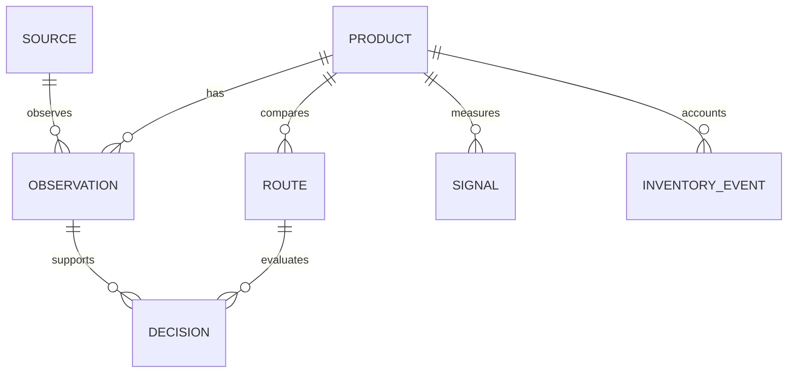

# KESTREL Arbitrage V1 implementation

This is a separate local research desk with an observation board, exact-product dossiers, channel comparisons,
capital planner, top/category views, inventory, planning, source controls and in-app setup guides. It adds no
marketplace purchase/listing/repricing path and does not modify the Stocks, Crypto or Solana trading models.
Wider market coverage and completed-sale history remain access/data work, not features to simulate with demo rows.

## Architecture and contracts

Existing Python, FastAPI, SQLite/WAL, HTTPX, Pydantic and loopback browser boundary are reused. No new dependency,
GPU, cloud server, paid model or trading-path LLM was introduced. The frontend is local vanilla JavaScript/CSS/SVG.
`/api/capabilities` exposes versioned input schemas; `/api/setup-guides` exposes the guide data shown in Settings.



The database is `DESK_HOME/arbitrage/db/arbitrage.db`; its locks and runtime files are under the same independent
home. Credentials are a separate owner-only `arbitrage-credentials.json` beside the configured trading secrets
file; that existing file is never read to borrow credentials or edited. Default trading capital is not imported.
Business capital starts unknown. Inventory cost is part of that business capital, not extra cash.

Code boundaries:

| Files | Responsibility |
| --- | --- |
| `contracts.py`, `repo.py` | Validated decimal/timestamp/identity inputs, independent schema checksum, read-only readers, immutable evidence/events |
| `sources.py` | Fixed-host robots-aware JSON-LD acquisition; no arbitrary URL fetch, redirect, cart or login |
| `ebay.py`, `integrations.py` | Optional bounded read-only production Browse searches and independent atomic private credentials |
| `runner.py` | Single process-held collector lock, bounded batches, source rotation, pause, cancellation, storage/HTTP budgets |
| `economics.py`, `inventory.py` | Conservative monetary rounding, gates, integer baskets, validated lot accounting |
| `heat.py`, `views.py` | Dated raw metrics and comparable-cohort descriptive ranks; projections never manufacture missing data |
| `evidence.py` | Prospective scenario/rejection records with full retained input records and a fingerprint |
| `web.py`, `static/*`, `cli.py` | Local UI, CSRF/same-origin controls, explicit local writes, guides, independent commands |
| Shared `ops/launcher.py`, `cli.py` | Explicit optional Arbitrage icon/window; existing default three-desk startup stays unchanged |

Do not edit released schema v1 DDL after operator use. Add an explicit additive migration for future schema changes.
GET projections use a read-only SQLite connection and do not spawn workers, migrate, authorize accounts or trade.
Collector startup is a lifespan action. Pause persists; closing a temporary test server cancels its own task.
An existing separate one-pass collector is respected and the dashboard acquires its lock when it finishes.

## Evidence and identity

An eBay listing is a distinct identity until proved equivalent. Keyword similarity never merges products. Only
active fixed-price summaries become asking-price observations; auction bids are excluded. Adafruit markup must
contain one exact Product and one fixed Offer. Unknown pack, condition, delivery and price-range semantics are
not inferred. GTIN checks length/check digit and stores a 14-digit canonical representation.

Confirmed metadata edits to model, brand, variant, GTIN, pack or condition invalidate earlier destination approval.
An offer with incompatible immutable identity cannot qualify. Historical asking prices are not assumed exact
comparables merely because they share a mutable product ID. Current exact identity needs brand/model or GTIN,
pack and condition review; the destination requires its own operator review and eligibility evidence.

Availability tiers are `UNKNOWN`, `DECLARED_AVAILABLE`, `UNAVAILABLE`, `VERIFIED_AVAILABLE`. Automatic retailer/API
records use declared availability at most. A regional check is explicitly an **operator attestation**, not a
stock reservation or a guarantee. Verification lasts at most five minutes for qualification; the guard checks
observation age even if a client submits a longer expiry. Failed later source access also vetoes that old check.
Automatic observation `at` is the poll timestamp; source-job success and prospective decision times establish
when acquisition completed. External source update/event time is unknown unless separately supplied. Use the
recorded decision time for prospective replay, not the earlier poll time. Unobserved time intervals are gaps. Price charts plot observation dots at real recorded timestamps, not invented
candles or carried-forward sales. Imported reported-sale prices are a separate series and retain provenance.

## Economics and cash constraints

All money is decimal. Acquisition and fee costs round upward to cents; receipts/profit round downward.
Let `a` be item purchase price, `s` per-unit acquisition shipping and `t` purchase tax. Let `p` be gross seller
receipts, `f` the reviewed effective variable-fee fraction, and `c` fixed selling fees plus all per-unit
fulfillment/inbound/prep/outbound expenses, returns/write-off allowance and allocated incremental overhead.

```
landed_cost = ceil_cent(a + s + t)
estimated_net = floor_cent(p) - ceil_cent(p*f) - landed_cost - ceil_cent(c)
stress_net = same calculation at reviewed conservative stress price
break_even = ceil_cent((landed_cost+c)/(1-f)), only when f < 1
ROI = estimated_net/landed_cost, only when landed_cost > 0
capital_day_efficiency = ROI/conservative_days_to_cash
```

Gross seller receipts must include buyer-paid shipping if applicable and exclude taxes remitted directly by the
marketplace. If the fee base includes additional taxes/charges, incorporate the extra fee in the reviewed effective
rate/fixed fee; this simple calculator is not a universal marketplace fee engine. Refunds, storage, advertising,
return handling, removal and subscriptions must be accounted for where material. No guessed fee improves the base
case. Cross-currency inputs produce no profit arithmetic; inventory currency is explicit and cannot be
relabelled by changing Settings after the first event. Fees and prices carry a dated version and evidence note. Actual fee-estimation APIs are not connected.

Illustrative **synthetic** accounting example: purchase $50, shipping $1, tax $1, receipts $100, effective fees
10%, fixed/fulfillment/returns/overhead $1+$5+$2+$1. Landed cost is $52; estimated net $29; at an $80 stress price,
net $11; break-even $67.78. These numbers are not current marketplace fees, a live offer or a profit result.

Qualification requires exact match, current regional positive-quantity verification, supported seller eligibility,
all material costs, same currency, fresh reviewed price/fee scenario, supported demand quantity, cash timing and
subscription budget. Default hurdles are $3 estimated net, positive stress net, <=60 days to cash and $0 added
monthly channel subscription. No score bypasses these gates.

The bounded greedy baseline orders qualifying routes by stress profit per unit, then stable ID; considers at
most 200; chooses one destination per product and integer units. It is **not a global knapsack optimum**.
Default caps: 20% per product, 60% per channel, five units per product. Existing product inventory reduces product
room. Because existing inventory has no reliable final destination, its commitment is conservatively charged
against every channel cap. Cash available is capital minus reserve minus inventory commitment. No leverage or
profit-based automatic increase exists. “Keep cash” is always shown. Different objectives can produce different
baskets; prospective comparisons must earn any later optimizer complexity.

## Heat definitions and unknown states

Heat is descriptive, has zero influence on qualification and is never a success probability.
Current metrics remain separate by channel, metric, category, condition and pack count. Uncategorized/unknown
pack cohorts abstain. Window is seven days; at least three observations on two distinct dates, latest within two
days, and at least five comparable products are required for a rank. These are unvalidated display heuristics.

* Flow metrics: sum observed `OWN_SALE`, `CONFIRMED_UNITS`, `MENTIONS` or `SOLD_LISTINGS` counts in the window.
  These labels remain distinct. An observed subtotal is not total market volume or proof of complete coverage.
* Stock/proxy metrics: latest `VIEWS`, `WATCHERS` or `OFFERS` value. Repeated snapshots are not summed into sales.
* Rank: `100*(count(cohort<value)+0.5*count(cohort==value))/cohort_size`.
  COOL <25; MODERATE <60; WARM <85; HOT >=85. Known zero activity is COOL; missing evidence is UNKNOWN.
  Competition rank measures pressure and is not a purchase endorsement.
* Same-source asking-price baseline: median of prior daily medians in a 30-day window with enough distinct days,
  same currency and compatible confirmed immutable identity. Discount is `1-current_price/baseline`.
  No baseline is shown when those conditions fail; this is not a completed-sales valuation.
* Momentum and sell-through stay unknown until interval-complete demand/attention coverage and suitable
  inventory/time-to-sale cohorts exist. Do not manufacture a confident value merely to fill six badges.

This is not a calibrated predictive model, a market-wide popularity estimate or a validated purchase filter.
Signals and inventory events require unique IDs; reusing an ID with identical contents is idempotent and changing
its contents is rejected. Own transaction records are not inferred from external attention or asking prices.

## Inventory and outcomes

Each lot begins with one positive RECEIVE and its total landed cost. RESERVE/RELEASE change availability, not
physical stock. Release a reservation before SELL. SELL stores total **net** receipts. RETURN stores the actual
refund and quarantines the returned units; they cannot be sold until RESTOCK. DISCARD_RETURN records returned
stock write-off; DAMAGE handles available physical stock. ADJUST_COST is positive and allowed before the first
sale only, so a later refund cannot rewrite historical cost basis. Late/backdated events and excess quantities
are rejected. Sale/refund amounts must already include applicable actual costs; they are not automatically
reconciled against seller statements. Inventory corrections/reversals beyond these events remain future work.

For a lot: `available = physical_units - reserved`; `capital_committed = unit_cost*(physical+quarantined)`;
`realized_recorded_profit = net_receipts - refunds - disposed_cost_basis`. These are business records, not paper
trading returns. The event limit is 20,000; reaching it fails explicitly rather than silently truncating balances.

## Research registry and next evidence

Worker evaluations retain scenario results and rejected routes, exact source observation, product, route, business
settings, source health, decision time and fingerprint. Unchanged decisions deduplicate. Up to 5,000 records are
kept; eBay API-derived records expire with its 24-hour cache. Replay is limited to retained full records.

Freeze `arbitrage-prospective-scenarios-v1`, inputs, gates, greedy objective and heat formula before collecting an
evaluation period. Compare keeping cash, the unchanged greedy baseline and any proposed heat/ranking additions at
matched capital, source coverage, product/channel limits and purchase-time availability. Never simulate a past
purchase using later observed sale prices. Record sold-out/restricted/false matches and dead stock, not winners
alone. Compare projected versus actual delivered cost, fees, net profit, sell-through, payout days, returns and
write-offs from actual own records. Evaluate incremental channels after their incremental cost and effort.

Use chronological development/evaluation windows and an untouched final period; group related products,
promotions, sources and time periods when estimating dependence-aware uncertainty. Register all tried formulas.
Do not choose parameters on the final period or declare an edge from a fixed count or synthetic success. Promotion
to ranking/filtering needs favorable net incremental outcomes and uncertainty after costs; capital growth requires
separate evidence, exposure control and actual cash. Sparse or missing transaction evidence means remain advisory.

## Hardware and storage budget

Target: Ryzen 7 7730U, 16 GiB shared RAM, Linux Mint, home Wi-Fi/sleep, no new paid infrastructure.
One async HTTP client, serial source work, up to five sources per cycle, 300-second default interval, 15-second
request timeout, 2 MB response limit, robots delay and per-source failure delay. At most 20 eBay summaries/search;
application tokens are memory-only. Local persistent eBay cap is 2,000 HTTP attempts/UTC day, including token
calls, with global 429 backoff and Retry-After. Provider quotas may be lower; check actual account rules.

100 source definitions, 2,000 products/routes, 5,000 observations per UI projection, 20,000 signal/inventory records.
Offer/route comparisons have a separate 5,000-pair guard before evaluation. Exceeding it leaves observations
visible and suspends route calculations/baskets with a clear message; unused routes can be paused in the UI.
History is indexed by product/source/currency, avoiding repeated cross-product scans. At catalog capacity, only
untouched, unreferenced eBay API candidates can be evicted (oldest first). Manual/reviewed records, route references,
signal evidence, explicitly linked sources and inventory are protected; protected-capacity exhaustion fails explicitly.
Price retention: 90 days/100,000 observations; API eBay cache 24 hours pending licensing review. Inventory is not
pruned. Below 512 MiB free disk, collection stops with an explicit fault while cached read views remain usable.
There are no raw HTML archives or unbounded app logs. SQLite FULL synchronization protects monetary event commits.
Hard power loss still needs real-system validation; this build does not claim a power-failure experiment occurred.

Synthetic cloud benchmark: 500 products, 5,000 observations, 500 routes; 0.0796 s snapshot wall time, 46.2 MiB
peak process RSS, ~9.4 MB database/WAL, 2.01 MB serialized projection. See `validation/resources-synthetic.json`.
These are cloud measurements, not measurements on the Dell. A proposed laptop acceptance budget is <250 MiB backend
RSS and <1 second warm snapshot at that workload; measure after installation. Browser memory is separate.
